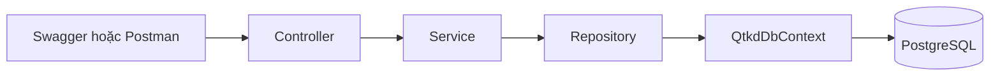

# Thiết kế tuần 05 - Nền tảng QTKD

## Mục tiêu

Xây dựng nền tảng Web API có thể kết nối PostgreSQL và đọc dữ liệu `Customer` và `Contract` từ database. Mã nguồn tuần 05 sẽ được tiếp tục sử dụng cho tuần 06 và tuần 07.

## Phạm vi

- Tạo solution `QTKD.sln` và một project `src/QTKD.Api` chạy trên .NET 10.
- Dùng ASP.NET Core Web API, Entity Framework Core và PostgreSQL.
- Tạo bốn entity: `Customer`, `Contract`, `PriceList`, `PriceItem`.
- Tạo migration đầu tiên và dữ liệu mẫu trong PostgreSQL.
- Cung cấp đúng hai endpoint: `GET /api/customers` và `GET /api/contracts/{id}`.
- Viết README hướng dẫn cấu hình và chạy project.

Không triển khai API tạo, sửa, xóa; không triển khai Submit Contract, Approval, Payment, giao diện web, ký điện tử hoặc project kiểm thử trong tuần 05.

## Phương án kiến trúc

`QTKD.Api` được chia thành `Controllers`, `DTOs`, `Services`, `Repositories`, `Data`, `Entities` và `Migrations`. Cách này phân biệt được API, xử lý nghiệp vụ và truy cập dữ liệu.

## Cấu trúc repository

```text
source/
|-- QTKD.sln
|-- src/
|   `-- QTKD.Api/
|       |-- Controllers/
|       |-- DTOs/
|       |-- Data/
|       |-- Entities/
|       |-- Migrations/
|       |-- Repositories/
|       `-- Services/
|-- docs/
|   `-- architecture.md
|-- .gitignore
`-- README.md
```

Thư mục `tests/` chỉ được tạo ở tuần 07 khi đề yêu cầu xUnit.

## Luồng xử lý



- Controller nhận HTTP request và trả HTTP response.
- Service điều phối truy vấn và chuyển Entity thành DTO.
- Repository chứa truy vấn EF Core.
- `QtkdDbContext` khai báo bảng, khóa và quan hệ database.

## Mô hình dữ liệu

### Customer

- `Id`: `int`, khóa chính.
- `Name`: `string`.
- `Status`: `string`.
- Một Customer có nhiều Contract.

### Contract

- `Id`: `int`, khóa chính.
- `ContractNo`: `string`.
- `CustomerId`: `int`, khóa ngoại đến Customer.
- `StartDate`: `DateOnly`.
- `EndDate`: `DateOnly`.
- `Status`: `string`.

### PriceList

- `Id`: `int`, khóa chính.
- `Name`: `string`.
- `EffectiveDate`: `DateOnly`.
- Một PriceList có nhiều PriceItem.

### PriceItem

- `PriceListId`: `int`, khóa ngoại đến PriceList.
- `ServiceCode`: `string`.
- `UnitPrice`: `decimal`.
- Khóa chính ghép gồm `PriceListId` và `ServiceCode`.

## Dữ liệu mẫu

Dữ liệu mẫu được khai báo bằng EF Core model seeding và ghi vào PostgreSQL khi chạy migration; API không trả danh sách viết sẵn trong bộ nhớ.

- Customer 1: `Công ty Minh Phát`, trạng thái `Active`.
- Customer 2: `Công ty Đại Dương`, trạng thái `Active`.
- Contract: `HD-2026-018`, thuộc Customer 1, từ `2026-10-01` đến `2027-09-30`, trạng thái `Draft`.
- PriceList: `Bảng giá dịch vụ 2026`, hiệu lực `2026-10-01`.
- Hai PriceItem mẫu dùng mã `SVC001` và `SVC002`. Mã và đơn giá chỉ là dữ liệu demo, không phải quy tắc nghiệp vụ đã xác nhận.

## API tuần 05

### GET /api/customers

- Trả danh sách Customer từ PostgreSQL theo thứ tự `Id`.
- Phản hồi `200 OK` với các trường `id`, `name`, `status`.

### GET /api/contracts/{id}

- Đọc Contract theo `id` từ PostgreSQL.
- Phản hồi `200 OK` với `id`, `contractNo`, `customerId`, `startDate`, `endDate`, `status`.
- Phản hồi `404 Not Found` nếu không tồn tại.

## Cấu hình và bảo mật

- Tên database đề xuất: `qtkd_db`.
- Connection string dùng khóa `ConnectionStrings:QtkdDatabase`.
- Mật khẩu PostgreSQL được lưu bằng .NET User Secrets, không ghi vào `appsettings.json`, README hoặc Git.
- Swagger chỉ dùng để thử hai endpoint tuần 05.

## Kiểm chứng

- Build project không có lỗi.
- Chạy migration và kiểm tra bốn bảng, khóa chính và khóa ngoại trong PostgreSQL.
- Xác nhận dữ liệu mẫu tồn tại trong database.
- Gọi hai endpoint qua Swagger và đối chiếu response với dữ liệu PostgreSQL.
- Thực hiện lại các bước trong README từ môi trường sạch trước khi nộp.
