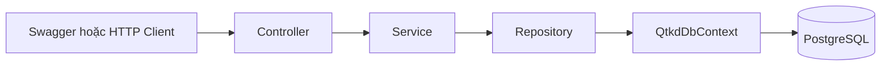
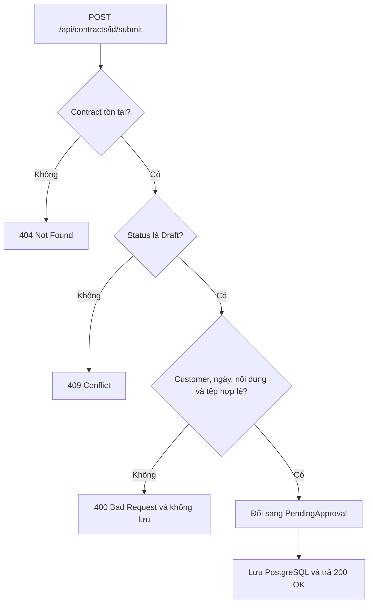

# Kiến trúc QTKD - Tuần 06

## Cấu trúc

```text
source/
|-- QTKD.sln
|-- src/QTKD.Api/
|   |-- Controllers/
|   |-- DTOs/
|   |-- Data/
|   |-- Entities/
|   |-- Migrations/
|   |-- Repositories/
|   `-- Services/
|-- docs/
|   |-- architecture.md
|   `-- week06-api.md
|-- .gitignore
`-- README.md
```



- Controller nhận request, gọi service và chọn HTTP status phù hợp.
- Service kiểm tra quy tắc nghiệp vụ, chuyển Entity sang DTO và quyết định khi nào được lưu.
- Repository chứa các truy vấn EF Core.
- `QtkdDbContext` khai báo bảng, khóa, quan hệ và dữ liệu mẫu.

## Luồng Submit Contract



Không có đường chuyển trực tiếp từ `Draft` sang `Approved`. Approval workflow đầy đủ chưa nằm trong phạm vi Tuần 06.
